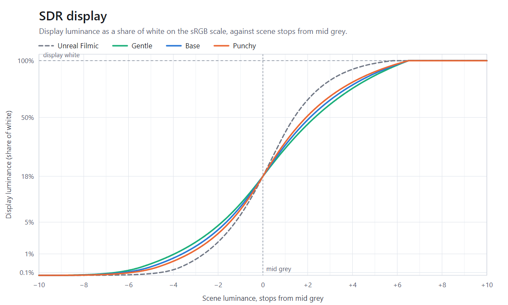
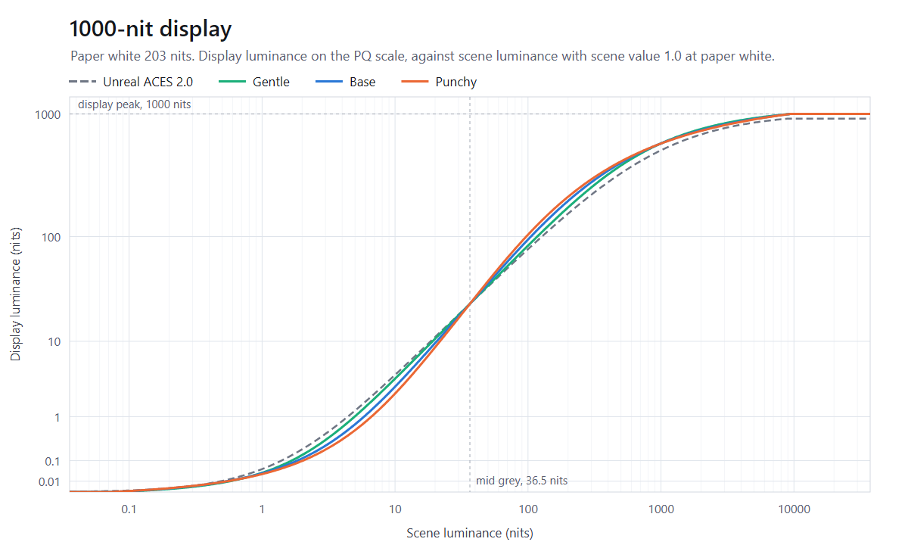
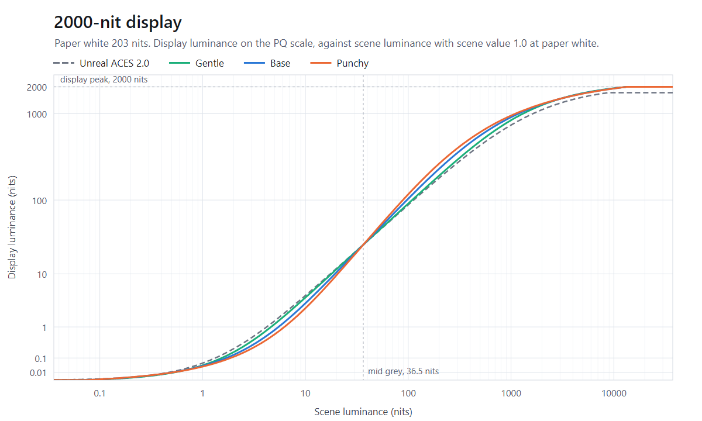
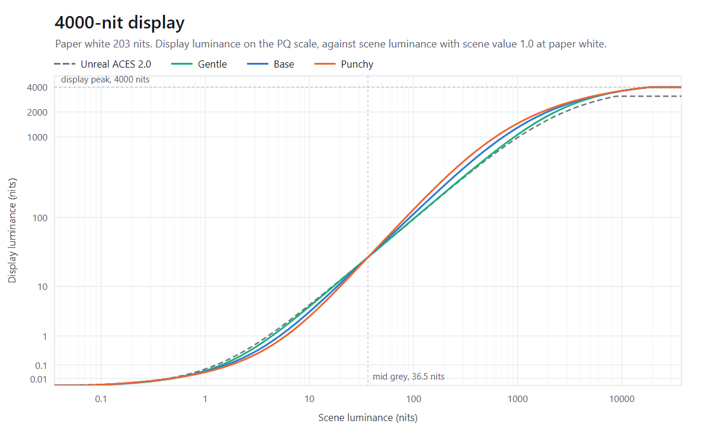

# AgX HDR

Get it on Fab: https://www.fab.com/listings/c6218605-2f1e-4cb9-a45a-d94fba669b90

AgX HDR replaces Unreal Engine's tonemapper with AgX. SDR displays get Blender's AgX. HDR displays get the same sigmoid laid out over the display's range: black nine stops below mid gray, a shoulder that ends at the display's peak, and mid gray where ACES 2.0 puts it, so exposure and paper white behave as before.

The rest of the built-in tonemapper's work carries over: auto and manual exposure, local exposure, bloom with its dirt mask, lens flares, chromatic aberration, sharpening, vignette, film grain, color grading, camera fades and dithering. The few things that cannot be carried over are listed under [Known limitations](#known-limitations). The Film slope, toe, shoulder and clip settings, Blue Correction and Tone Curve Amount take effect on every view, including views set to Standard ACES, which ignores them.

Check the comparison files in this repository to see the differences.

## Requirements

- The desktop renderer at SM5 or above, on Windows, Linux or Mac. The mobile renderer keeps its own tonemapper.
- For HDR output, HDR has to be allowed and turned on: set `r.AllowHDR=1` under `[SystemSettings]` in `Config/DefaultEngine.ini` (it is read-only at runtime), then call `UGameUserSettings::EnableHDRDisplayOutput` from the game. In the editor, turn on Editor Preferences > General > Experimental > HDR > Enable Editor Support for HDR Monitors and restart the editor. On Linux the engine never switches to an HDR output format, so only SDR is available there.

The Film > Method setting of a post process volume and `r.LUT.TonemappingMethod` no longer matter: Filmic and Standard ACES views are both replaced.

## Installation

Put the plugin in your project's `Plugins` folder, or install it from Fab. Enable AgX HDR in Edit > Plugins (Rendering category) and restart the editor. It is active right away; there is nothing to place in a level.

## Contrast settings

`r.AgXHDR.Contrast` picks one of three curves, or hands tonemapping back to the engine:

| Value | Setting | SDR slope at mid gray | HDR contrast at mid gray (PQ code per stop) |
|---|---|---|---|
| 0 | Off: the engine's own tonemapper | | |
| 1 | Gentle | 2.13 | 0.080 |
| 2 | Base (default) | 2.40, Blender's | 0.090 |
| 3 | Punchy | 2.67 | 0.100 |

It can change at any time, from the console or from code, and applies from the next frame. For a project-wide default, add it to `Config/DefaultEngine.ini`:

```ini
[SystemSettings]
r.AgXHDR.Contrast=3
```

A settings menu has to write above that ini priority. A value set with `ECVF_SetByGameSetting` loses to the `[SystemSettings]` entry, so use `ECVF_SetByGameOverride`:

```cpp
IConsoleManager::Get().FindConsoleVariable(TEXT("r.AgXHDR.Contrast"))->Set(1, ECVF_SetByGameOverride);
```

That value is not saved anywhere, so the menu has to store the player's choice itself and set it again at startup.

Higher settings steepen the mid-tones and darken the shadows. All three keep mid gray and the white point where they are. In HDR the order flips in the deepest shadows: from about six stops below mid gray down to black, the higher settings come out slightly brighter.

In SDR, against Unreal's Filmic curve:



AgX is the flatter of the two around mid gray. It keeps more of the shadows: four stops below mid gray, Base shows 0.72% of white where Filmic shows 0.20%. It also takes longer to get to white, reaching 90% at 5.3 stops above mid gray where Filmic gets there at 3.9.

On HDR displays the curves follow the peak. Display luminance in nits on a 1000-nit display with paper white at 203 nits:

| Scene, stops from mid gray | Scene, nits | ACES 2.0 | Gentle | Base | Punchy |
|---|---|---|---|---|---|
| -8 | 0.14 | 0.00061 | 0.00035 | 0.00050 | 0.00056 |
| -4 | 2.3 | 0.28 | 0.20 | 0.15 | 0.13 |
| 0 (mid gray) | 36.5 | 24.4 | 24.4 | 24.4 | 24.4 |
| +2 | 146 | 115 | 127 | 145 | 159 |
| +4 | 585 | 374 | 432 | 448 | 456 |
| +6 | 2339 | 722 | 793 | 776 | 766 |
| +8 | 9354 | 917 | 1000 | 1000 | 1000 |

Scene nits count a scene value of 1.0 as paper white, so they are what each pixel would show with no tonemapping at all. The ACES 2.0 column is Unreal's Standard ACES with its default LUT shaper (`r.LUT.Shaper 0`), which stops reading scene values 7.9 stops above mid gray and so never gets past 917 nits. The same curves on 1000, 2000 and 4000-nit displays, with scene luminance in nits on the same convention and the output on the PQ scale so equal heights read as roughly equal steps in brightness:







## The curves

Both curves use Jed Smith's tunable sigmoid, which Troy Sobotka's AgX and Blender's AgX are built on. The input is the scene value of each channel after exposure, counted in stops from mid gray (0.18).

SDR is Blender's AgX: a 16.5-stop window from 10 stops below mid gray to 6.5 above, toe and shoulder powers of 1.5, and an output decoded with a 2.4 power, which puts mid gray at 18% of white.

HDR:

- Black: 9 stops below mid gray. Darker scene values come out as 0.
- Mid gray: the luminance ACES 2.0 gives it for the current paper white, peak and `r.HDR.Aces.SceneColorMultiplier`.
- White point: 8 stops above mid gray on a 1000-nit display, half a stop higher for each doubling of the peak (+7.5 at 500 nits, +9 at 4000). The display's peak is reached there and held above it.
- The curve runs over PQ code values, so the contrast setting is the same perceptual slope on every display. The shoulder power scales with the peak by (peak / 1000)^log10(2), the rule Blender's AgX HDR applies to peak over reference white. That keeps the knee about the same shape as the white point moves up.

### Peak and paper white

Both are read every frame from the same place the engine's tonemapper reads them, the viewport's HDR settings, so in-game HDR brightness controls keep working. The peak comes from `r.HDR.Display.MaxLuminance` while `r.HDR.Display.OverrideOSMaxLuminance` is on, and from the operating system otherwise. The engine sets `r.HDR.Display.OverrideOSMaxLuminance` from `UGameUserSettings::IsHDRCalibrationUsed()`, so a peak slider only takes effect after the game calls `UGameUserSettings::SetHDRCalibrationUsed(true)`.

## Color

Color goes through the AgX formation. After grading, the color is converted to Rec.2020 and pulled slightly toward its own neutral axis (AgX's inset). The curve then runs on each channel separately and the result is pushed back out. Run per channel, the curve makes bright saturated colors drift toward white as they brighten, and 60% of the hue shift this causes is then undone. Finally the color is held inside the display's limiting gamut and below its peak, then written in the display's own gamut.

## Film settings

The Film settings of a post process volume shape the curve relative to the contrast setting. At the engine's defaults (slope 0.88, toe 0.55, shoulder 0.26, black clip 0, white clip 0.04) the curve is the one in the tables above. Each setting moves it the way it moves the engine's Filmic curve:

| Setting | Effect |
|---|---|
| Slope | Scales the slope through mid gray. Higher means more contrast. |
| Toe | Scales the toe power. Higher means darker deep shadows. |
| Shoulder | Scales the shoulder power. Higher means brighter highlights below the white point. |
| Black clip | Moves the black point toward mid gray. At 0.5 everything more than 5 stops below mid gray is black in SDR, 4.5 in HDR. |
| White clip | Moves the white point toward mid gray above 0.04 and away from it below. |

Mid gray never moves.

## What carries over from the engine's tonemapper

The pass reproduces the engine's tonemapper step by step, with the same settings, console variables and show flags:

- Exposure: auto exposure (histogram and basic), manual exposure, the physical camera settings, exposure compensation and its curve, fixed exposure, and exposure in debug view modes.
- Local exposure, bilateral and fusion. The engine's local exposure textures are not available to a tonemapper replacement, so the plugin builds its own copy with the engine's shaders.
- Bloom (Gaussian and convolution), lens flares and the bloom dirt mask. With convolution bloom, the plugin works out the scene color scale from the kernel as the engine does, so the kernel's center is not added to the image twice.
- Scene color tint, chromatic aberration, sharpening (`r.Tonemapper.Sharpen`), all three vignette types, and film grain.
- Color grading: white balance and color temperature, saturation, contrast, gamma, gain and offset for the whole image and for shadows, mid-tones and highlights, Expand Gamut, Blue Correction and Tone Curve Amount. With color grading turned off (the Color Grading show flag or `r.Color.Grading 0`) the defaults apply, as in the engine.
- Color grading LUT textures, blended as the engine blends them, and `r.Color.Min/Mid/Max`, on SDR output.
- Camera fades.
- Output for sRGB, Rec.709 and explicit-gamma displays, HDR10 (PQ) and scRGB HDR, and scene captures with Final Color (with tone curve) in Linear sRGB gamut. SDR sRGB output is encoded with the 2.4 power AgX is defined with, as Blender encodes it. Set `r.LUT.TonemappingSDRInvEOTF 0` to encode with the sRGB curve instead.
- Quantization dither (`r.BackbufferQuantizationDitheringOverride`), alpha propagation (`r.PostProcessing.PropagateAlpha`), the HMD hidden area mask, and gamma-only output when the Tonemapper show flag is off.

Blue Correction defaults to 0.6 and Expand Gamut to 1, as in the engine. Blue Correction desaturates bright saturated blues a little to keep them from turning violet, and Expand Gamut pushes bright saturated colors outward. Blender's AgX has neither step, so set both to 0 to match Blender. Grays are unaffected.

## What it leaves alone

- Scene captures that store linear scene light (Final Color (HDR) in Linear Working Color Space) and linear EXR output keep the engine's tonemapper.
- Where a post process material replaces the tonemapper, the material wins.

## Performance

Measured on an RTX 5090 in a full game scene, switching `r.AgXHDR.Contrast` between 0 and 2 every 100 frames:

| Output | Engine's tonemapper | AgX HDR | Difference |
|---|---|---|---|
| 1920x1080 | 14 us | 46 us | +32 us |
| 2560x1440 | 20 us | 53 us | +33 us |
| 3840x2160 | 42 us | 80 us | +39 us |

The tonemap pass itself costs the same as the engine's. The difference is local exposure, which the plugin has to build a second time (see [Known limitations](#known-limitations)). With local exposure at its neutral settings, the plugin costs the same as the engine.

The color LUT is 64x64x64 and is only rebuilt when something it depends on changes: grading, Film settings, a camera fade, the contrast setting or the display. A rebuild takes about 7 us. Up to four LUTs are kept, so views with different settings, such as split screen or scene captures, do not rebuild each other's every frame. GPU time shows up under "AgX HDR" in `stat gpu` and in CSV profiles.

## Judging the result

The editor outputs HDR as scRGB, while a packaged Windows build sends PQ, and displays and drivers do not always treat the two signals the same way. Make final look decisions in a packaged build, on the kind of HDR display you are targeting.

## C++ API

Add `AgXHDR` to your module's dependencies to use the public headers. The ones most likely to be useful:

- `AgXHDRCurve.h`: `AgXHDR::MakeSDRCurve` and `AgXHDR::MakeHDRCurve` build the curve for a contrast setting, display and Film settings; `FAgXHDRCurveShape::Evaluate` maps a scene value to display light. An HDR calibration screen can use them to draw the curve.
- `AgXHDROutputDevice.h`: the display a view family renders for, resolved as the tonemapper resolves it.
- `AgXHDRViewExtension.h`: `GetContrast` returns the active setting.

## Tests

The AgXHDRTests editor module ships automation specs named `AgXHDR.*`, runnable from the Session Frontend or with `-ExecCmds="Automation RunTests AgXHDR"`. All of them run headless under `-nullrhi` except the `AgXHDR.Rendering` specs, which need a real RHI: they build LUTs, local exposure textures and the convolution bloom scale on the GPU and compare them with CPU references, and run the tonemap pass on synthetic inputs.

## Known limitations

- Contrast-adaptive variable rate shading reads a luminance image the engine's tonemapper writes as a side product. A tonemapper replacement has no access to it, so that VRS mode has nothing to work from while the plugin is active.
- With fusion local exposure the engine still builds its own fusion pyramid, which then goes unused, so fusion is computed twice. Bilateral local exposure, the default, is also built twice, but it works at a fraction of the screen resolution, and the engine's copy is still needed for bloom.
- Color grading LUT textures and `r.Color.Min/Mid/Max` do nothing on HDR output. The engine's Filmic tonemapper does apply them in HDR, because it grades an SDR image first and expands it afterward.
- Another plugin that replaces the tonemapper through its own scene view extension competes with this one. Only one of them runs; set `r.AgXHDR.Contrast 0` to make sure it is the other one.
- HDR output on Mac has not been tried.

## Support

Report problems at https://github.com/krojew/AgXHDR/issues.
